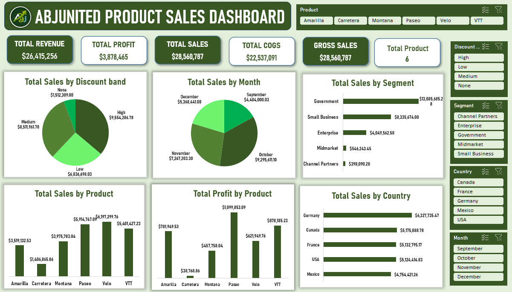

# Product Sales Dashboard (Excel)

## Overview
An interactive Excel dashboard that analyzes product sales performance
across products, customer segments, countries, discount bands and months.
The raw data and the dashboard are in one workbook.

## Dashboard Preview

## Key Metrics
- **Total Revenue:** $26,415,256
- **Total Profit:** $3,878,465
- **Total COGS:** $22,537,091
- **Gross Sales:** $28,560,787
- **Products analyzed:** 6

## Key Insights
- Government is the top segment, with $13.09M in sales.
- Germany is the top country, with $6.23M in sales.
- Paseo earns the highest profit ($1.10M).
- Carretera has the lowest sales and profit.
- October and December are the strongest months.
- High discount band has the most sales ($9.55M).

## Features
- Slicers to filter by Product, Discount Band, Segment, Country and Month
- KPI cards for revenue, profit, sales, COGS and gross sales
- Pie charts and bar charts for quick comparison

## Tools Used
- Microsoft Excel
- PivotTables and PivotCharts
- Slicers
- DAX measures

## Download
[Product_Sales_Dashboard.xlsx](dashboard/Product_Sales_Dashboard.xlsx)

## Author
**Adeleye Babatunde John**
GitHub: [abjunited](https://github.com/abjunited)
